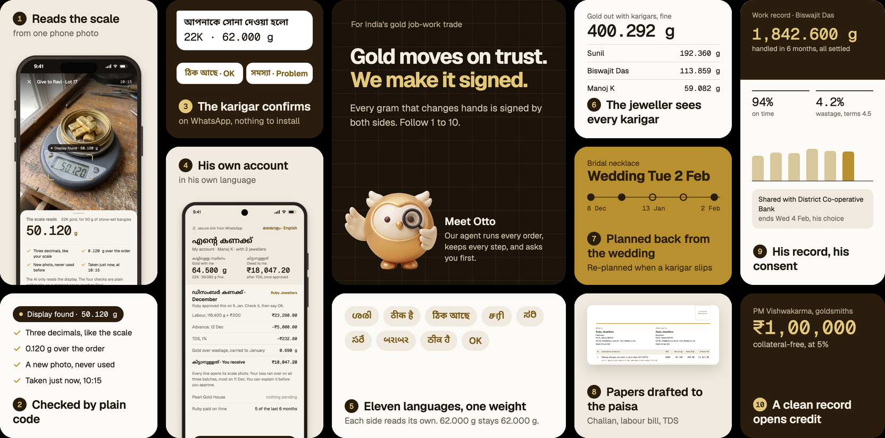
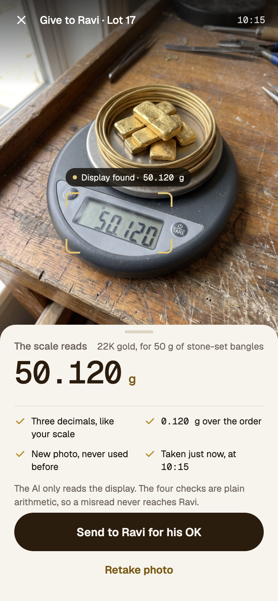
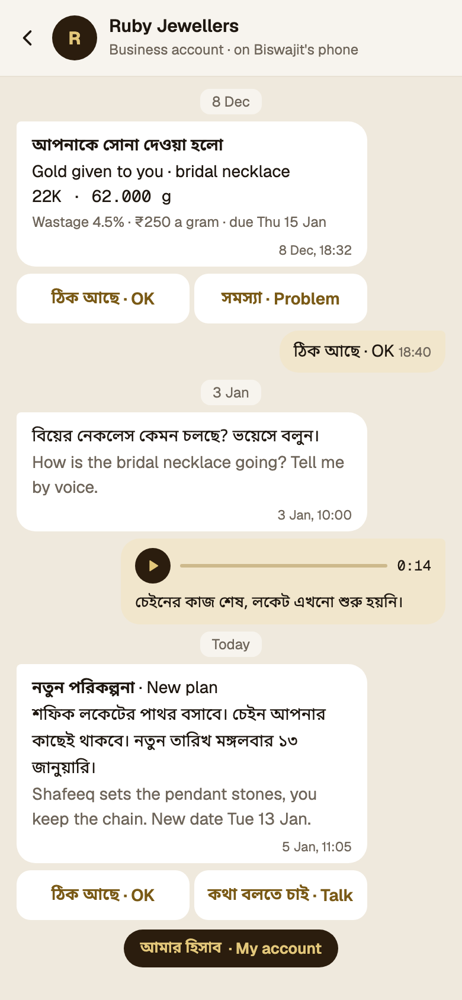
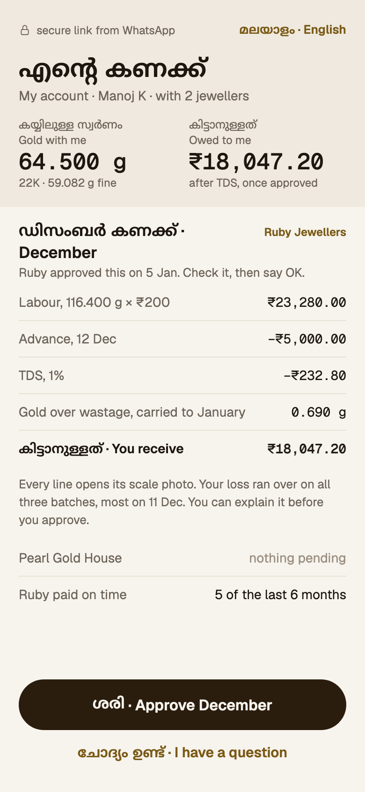
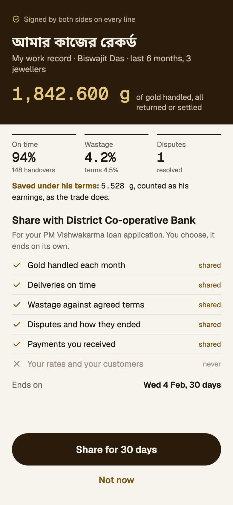
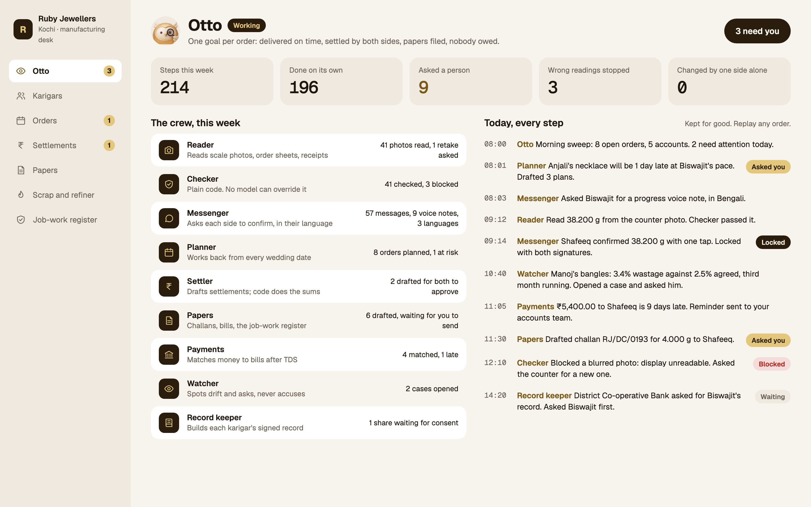
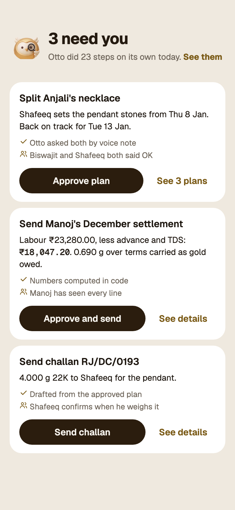
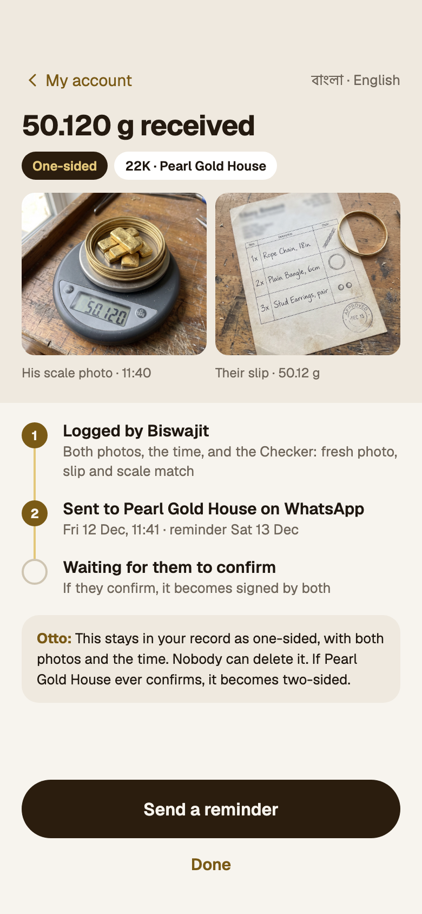
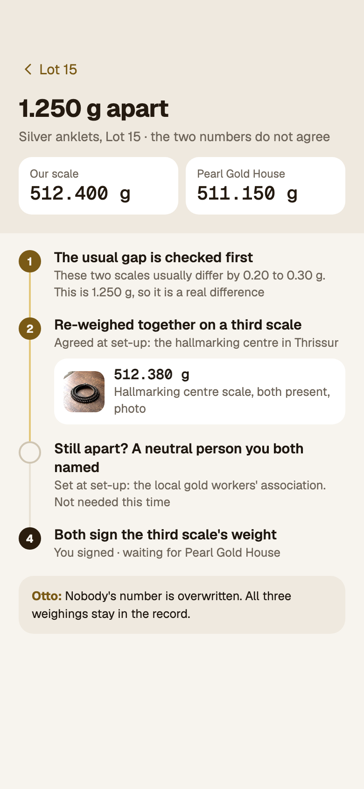
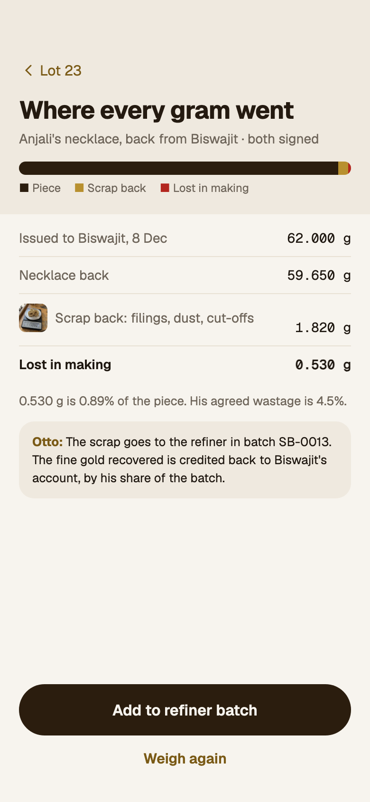

# Otto: every gram of gold, signed by both sides

Gold given to karigars is tracked on trust: a slip in a notebook, wastage agreed by word of mouth, deadlines chased by phone, accounts squared at month end. Otto makes every gram that changes hands signed by both sides, in each side's own language, and turn that signed history into the karigar's own record.

## The moment

It is 9 PM in a Thrissur workshop. Biswajit, a karigar from Bengal, has 124.300 g of a jeweller's gold on his bench and a bridal necklace due in ten days. The only record of that gold is a line in the jeweller's notebook. If the numbers ever disagree, it is his word against theirs, and he is the one with less power. *(Every name in this repo is a sample placeholder.)*

## We live this problem

Our family runs a gold and silver job-work unit in Kerala: 15 to 20 karigars at our benches, plus outside specialists, making ornaments for big jewellery shops. From our field interview with its founder, who worked as a karigar for years before starting the unit, so he has stood on both sides of the scale (paraphrased and translated from Malayalam):

- "We use our own gold. The shop gives back exactly the same weight, nothing extra."
- "There is no wastage deal. What is lost in making is our loss, at most half a gram in 100."
- "We are paid labour only, ₹350 a gram, by bank, and the shop cuts 1% TDS."
- "The gold comes back in about a week. The money takes about two."
- "Every delivery needs a challan and a labour bill, or a sale bill. Who hallmarks decides which."
- "We also give gold and orders to independent specialists, like chain makers."

Published research agrees: wastage is the karigar's wage (IIMA and XLRI, 2023, 123 karigars); new karigars are trusted with only 100 to 250 g; about 8.1 kg of gold vanished with karigars in 8 Mumbai-area cases in two years with no written record (Free Press Journal); and no jewellery software lets a karigar see his own balance or confirm a weight.

All ten statements, ten research findings, and what each one changed: [docs/FIELD-INTERVIEW.md](docs/FIELD-INTERVIEW.md).

## What it does

Every handover of gold or silver is signed by both sides:

1. **Photograph the scale.** A vision model reads the display.
2. **Plain code checks it.** Format, order of steps, a fresh photo, the known gap between two scales. No model can override it.
3. **The other side confirms** in their own language: one tap or a voice reply on WhatsApp, a PIN at the workshop bench, or a link. Nothing to install.
4. **Locked.** Nobody can change it alone. A correction is a new entry both sides sign.

From those signed entries the jeweller sees every karigar on one board, the karigar sees his own account in his language, settlements are drafted for both to approve, papers are drafted to the paisa, and the karigar's signed history becomes **his own record**, shared with a lender only with his consent and only until a date he sets.

| | |
|---|---|
|  |  |
|  |  |

## Otto AI, the agent crew

Otto AI is not a chatbot. One orchestrator holds a goal for every open order (*delivered on time, settled by both sides, papers filed, nobody owed*) and nine specialists do the work. Otto reads the same from both sides, like every entry it keeps.

| Agent | Job | Model or code |
|---|---|---|
| Reader | Reads the scale, order sheets, receipts, old notebook pages | Vision model |
| Checker | Format, order, fresh photo, scale gap, totals | Plain code only |
| Messenger | Asks each side to confirm, by text or voice, in 11 languages | Speech models |
| Planner | Works back from the wedding date; spots a late piece early; proposes re-plans | Model and date solver |
| Settler | Drafts settlements: fine gold, wastage against terms, labour, TDS | Code does the sums |
| Papers | Challan, labour bill, sale bill with HUIDs, job-work register, ITC-04 | Code and templates |
| Payments | Matches money to bills after TDS; late pay shows on both sides | Code |
| Watcher | Spots drift (wastage, limits, gold away near one year) and asks, never accuses | Code and anomaly scores |
| Record keeper | Builds the karigar's record; shares it only with his consent | Code |

**Models propose. Code decides. People approve.** Otto AI asks a person before money moves, a bill goes out, a date changes for someone else, a record is shared, or a dispute closes. Every step is written to one log, so any order replays from the first gram to the last rupee. Full design: [docs/AGENT-DESIGN.md](docs/AGENT-DESIGN.md).

| | |
|---|---|
|  |  |

## Fair when it is hard

| A jeweller who never signs | Numbers that do not agree | Where every gram went |
|---|---|---|
|  |  |  |
| The karigar logs it himself with both photos; it stays in his record as one-sided until they confirm. | The usual scale gap first, then a third scale both named, then a neutral person. Every weighing is kept. | Scrap is weighed back with the piece; the refiner's recovery is credited to him. |

## Every party, every size

Jewellers and counter staff, karigars and their helpers, head karigars, workshops like ours, customers with occasion dates, refiners, hallmarking centres, the CA, lenders and assisted kiosks each get their own way in: the app, bench mode at the workshop scale, WhatsApp, or a link. It fits a solo karigar at home and a national chain alike. Details: [docs/PRODUCT.md](docs/PRODUCT.md).

## Made for any phone, any network, any language

Voice first in 11 languages · one tap or a PIN for low literacy · WhatsApp or a link on an entry-level Android phone · photos wait offline and sync later · an assisted path at a kiosk for people without smartphones · consent that expires.

## Screen designs

The designed walkthrough, 22 pages of device mockups and bentos: [screens/screen-designs.pdf](screens/screen-designs.pdf) (each page also as an image in [screens/showcase](screens/showcase)). All 47 screens on their own, grouped by who uses them, in [screens/](screens/).

| Folder | Screens |
|---|---|
| [1-handover](screens/1-handover) | Weighing, confirming, bench mode, take-back, disputes and the way out, rejections, his own one-sided entries, scrap weighed back |
| [2-workshop-owner](screens/2-workshop-owner) | Set-up, orders, splitting work, deliveries, papers, payments, approvals |
| [3-jeweller](screens/3-jeweller) | Board of every karigar, a wedding order at risk, settlements, job-work register |
| [4-karigar](screens/4-karigar) | His own account in four languages, his record, a head karigar's two sides |
| [5-otto-agent](screens/5-otto-agent) | Otto AI's desk, what needs you, one order's full history |
| [6-customer-refiner-bank-cafe](screens/6-customer-refiner-bank-cafe) | Customer updates, refiner batch, bank view with consent, assisted kiosk |
| [7-overview-boards](screens/7-overview-boards) | Everyone on one record, every size and model, every language, field research |

## Sample papers

Drafted from signed entries, every number computed in code: [delivery challan](papers/lot19-delivery-challan.pdf), [labour bill](papers/lot19-labour-bill.pdf), [sale bill](papers/tax-invoice-sale.pdf), [monthly statement](papers/statement.pdf). All names, GSTINs and phone numbers are placeholders.

## Status

Design stage. What exists: designs for every party and size, the agent design, bills computed in code, field and published research. The bank feed, GST, e-way and IRN portals and the lender connection are simulated for now and labelled as such. Translations will be checked by native speakers from the trade.

## What we will measure

| Measure | Target |
|---|---|
| Scale readings right on real photos from our workshop | 98% or more |
| Wrong readings reaching anyone who signs | 0 |
| Voice replies understood in Malayalam, Bengali, Hindi, Tamil | 90% or more |
| Real lots tracked live in our workshop | grams, confirmations, papers, disputes |

## Research

- Field interview: the owner of our family's gold and silver job-work unit in Kerala. [docs/FIELD-INTERVIEW.md](docs/FIELD-INTERVIEW.md)
- [Every party in gold job work](docs/research/RESEARCH-PARTIES.md) · [Rules and credit](docs/research/RESEARCH-RULES-CREDIT.md)
- NCAER for GJEPC, Cluster Mapping Study (2020) · IIMA and XLRI (2023) · Free Press Journal (2024 to 2026) · Kerala Trade Circular 1/2025 · CGST Act s.143 · RBI gold metal loans (2026) · PM Vishwakarma.

## Team

**Zevora Labs**

- Soorya Krishna P R
- Jyothis Mariya Joy
- Bharath Krishna A B
- Navami Jith
